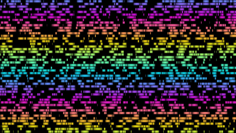
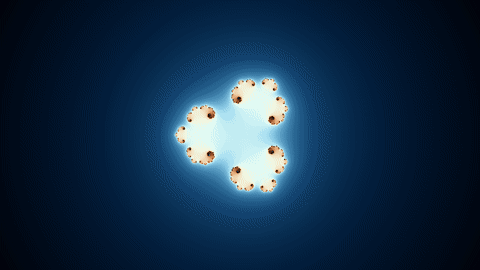
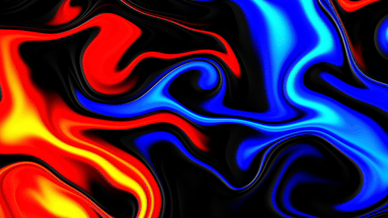

# Shaders generativos · Tiny Code

Colección de tres *fragment shaders* con patrones generativos y comportamiento dinámico, pensados para ejecutarse en el [editor de The Book of Shaders](http://editor.thebookofshaders.com/) y cumplir la restricción *tiny code* (máximo 512 bytes, contando los `uniform` y sin contar comentarios).

| # | Shader | Idea | Tamaño minificado |
|---|--------|------|------------------:|
| 1 | [Franjas de luz](#1-franjas-de-luz) | Filas de segmentos luminosos que se desplazan a distinta velocidad y se encienden y apagan al ritmo de un oscilador | 502 B |
| 2 | [Fractal de Julia cúbico](#2-fractal-de-julia-cúbico) | Conjunto de Julia de `z³ + c` que gira, hace zoom y cambia de forma con el tiempo | 510 B |
| 3 | [Fluido falso](#3-fluido-falso) | Rayas de color arrastradas por un campo de flujo incompresible, con relieve | 510 B |

## Estructura del repositorio

```
Shaders/
├── README.md
├── gif/
│   ├── franjas.gif
│   ├── julia.gif
│   └── fluido.gif
└── shader/
    ├── tinyCode/            ← versiones minificadas (≤ 512 B)
    │   ├── FranjasTinyCode.frag
    │   ├── JuliaTinyCode.frag
    │   └── FluidoTinyCode.frag
    └── comentado/           ← versiones legibles y comentadas
        ├── Franjas.frag
        ├── Julia.frag
        └── Fluido.frag
```

## Cómo ejecutarlos

1. Abre <http://editor.thebookofshaders.com/>.
2. Borra el contenido y pega la versión **minificada** (o la comentada, son equivalentes) de cualquiera de los shaders.
3. Todos usan únicamente `u_resolution` y `u_time`, que el editor proporciona.

---

## 1. Franjas de luz

### Idea
Inspirado en *the critical path* de [Ryoji Ikeda](https://hofryojiikeda.com/#/en/work/A1). La pantalla se divide en 50 filas. Cada fila es una cinta de bloques que se desplaza horizontalmente a su propia velocidad y sentido, y cada bloque está partido en segmentos de anchura aleatoria que se encienden o apagan. Un oscilador lento controla la «actividad»: con actividad baja casi todo está apagado y los segmentos son regulares; con actividad alta casi todo se enciende y las anchuras se vuelven muy desiguales.



### Desarrollo

1. **Filas.** `p = 50. * gl_FragCoord.xy / u_resolution.y` da 50 unidades de alto; `y = floor(p.y)` es el índice de la fila.
2. **Hash.** La macro `r(v) = fract(sin(dot(v, vec2(13, 7.9))) * 4e4)` es el ruido pseudoaleatorio clásico de The Book of Shaders con constantes acortadas. Se usan `#define` para no repetir el hash, el bucle (`L`) ni la fórmula de anchura (`W`), que aparecen dos veces.
3. **Oscilador global.** `t = abs(sin(u_time * .1))` va de 0 a 1 y vuelve, y gobierna todo el comportamiento dinámico.
4. **Desplazamiento por fila.** `x = p.x * .1 - u_time * (r(vec2(y)) * 5. - 2.5)`: cada fila tiene una velocidad aleatoria en [-2.5, 2.5], así que unas van a la izquierda y otras a la derecha. El factor `.1` hace que cada bloque mida 10 unidades.
5. **Identificador de bloque.** `b = floor(x) + y * 1e3` combina bloque y fila en un único número, para que dos filas no repitan el mismo patrón.
6. **Anchuras de los segmentos.** `W = .02 + pow(r(vec2(b, i)), 5. * t)`. Con `t = 0` el exponente es 0 y todas las anchuras valen igual; al crecer `t`, elevar un número de [0,1) a una potencia alta hace que la mayoría de los segmentos se vuelvan estrechos y unos pocos dominen. El `.02` evita anchuras nulas.
7. **Posición dentro del bloque.** Se suman las 10 anchuras (`T`) y se escala con `T *= fract(x)`: así el bloque siempre se rellena entero, sin que importe cuánto midan los segmentos.
8. **Segmento del píxel.** El segundo bucle recorre los segmentos acumulando su inicio `a`; el último cuyo inicio queda por debajo de `T` es el que contiene al píxel. Su intensidad es `sin(3. * (T - a) / W)`: un pulso que nace y muere casi en cero en los bordes (3 rad ≈ π), con lo que cada segmento queda separado visualmente del siguiente.
9. **Encendido.** `step(r(vec2(i, b)), t)` enciende el segmento si su número aleatorio queda por debajo de la actividad: cuanto mayor es `t`, más segmentos encendidos. Se usa `vec2(i, b)` en lugar de `vec2(b, i)` para obtener un aleatorio independiente del de la anchura.
10. **Color.** Paleta cosenoidal `.5 + .5 * cos(y * .2 + u_time + vec3(0, 2, 4))`, que da un arcoíris que recorre las filas con el tiempo. Se multiplica por `sin(3. * fract(p.y))` para dar a cada fila un perfil vertical redondeado y se aplica `sqrt` como corrección gamma aproximada.

---

## 2. Fractal de Julia cúbico

### Idea
Un conjunto de Julia de la iteración `z → z³ + c`, que tiene simetría de orden 3. El parámetro `c` describe un círculo de radio variable, así que el fractal se deforma continuamente, mientras la vista gira y hace zoom lentamente. El exterior se colorea con el número de iteraciones suavizado y el interior con un *orbit trap*.



### Desarrollo

1. **Coordenadas.** `u = (2. * gl_FragCoord.xy - r) / r.y` centra el origen y deja la altura entre -1 y 1 sin deformar.
2. **Zoom y rotación.** `z = u * (.5 * cos(t * .05) + 2.) * mat2(cos(t * .1 + vec4(0, 33, 11, 0)))`. El zoom oscila entre 1.5 y 2.5. La matriz de rotación usa el mismo truco de *code golf* de un solo `cos`: como 33 ≈ π/2 y 11 ≈ 3π/2 (módulo 2π), `cos(a + vec4(0, 33, 11, 0))` ≈ `(cos a, -sin a, sin a, cos a)`.
3. **Parámetro c.** `c = (.55 + .1 * sin(t * .3)) * sin(t * .2 + vec2(1.57, 0))`: `sin(x + vec2(π/2, 0))` es `(cos x, sin x)`, un punto sobre el círculo unidad, escalado por un radio que oscila entre .45 y .65.
4. **Multiplicación compleja con matrices.** `mat2(z, -z.y, z.x)` tiene por columnas `(x, y)` y `(-y, x)`, que es la matriz de «multiplicar por z». Así `M * M * z` calcula `z³` sin escribir las fórmulas de parte real e imaginaria.
5. **Iteración.** Hasta 99 iteraciones, con radio de escape 9 (`dot(z, z) > 81.`). En cada paso se guarda en `m` la mínima distancia al cuadrado al origen (*orbit trap*).
6. **Exterior: conteo suavizado.** Para evitar bandas se usa `i - log(log|z|² / (2·log 9)) / log 3`. En el código, `2·log 9 ≈ 4.4` y `1 / log 3 ≈ .91` (el 3 es el grado del polinomio). El resultado alimenta una paleta cosenoidal `.5 + .5 * cos(3.4 + t * .3 + n * .4 + vec3(0, .6, 1))` que además va rotando con el tiempo.
7. **Interior: orbit trap.** Los puntos que no escapan se colorean con `sqrt(m) * (.5 + .5 * cos(log(m) + t + p))`: el brillo depende de lo cerca que pasó la órbita del origen y el tono de su logaritmo, lo que dibuja los anillos internos.
8. **Viñeta.** `1. - .2 * dot(u, u)` oscurece suavemente las esquinas.

---

## 3. Fluido falso

### Idea
Un patrón de rayas de color se deforma arrastrado por un campo de velocidades que cambia con el tiempo, como tinta en agua. El rojo marca valores positivos, el azul negativos y el amarillo/cian los extremos; una derivada horizontal añade relieve. Para que la deformación no se acumule sin límite, la advección se reinicia periódicamente y dos capas desfasadas ocultan el reinicio.



### Desarrollo

1. **Dos puntos a la vez.** `q = (gl_FragCoord.xyxy + vec4(0, 0, 1, 0)) / u_resolution.y * 2.` guarda en un `vec4` el píxel (`q.xy`) y su vecino derecho (`q.zw`). Avanzar los dos juntos permite calcular después una derivada sin repetir todo el trabajo.
2. **Campo de flujo.** La velocidad es la suma de 6 ondas `l = 1..6`. Cada una tiene dirección `cos(l + vec2(0, 11))` ≈ `(cos l, sin l)` y empuja en la perpendicular `cos(l + vec2(11, 22))` ≈ `(sin l, -cos l)` (11 ≈ 3π/2 y 22 ≈ 7π, módulo 2π). Como el empuje es perpendicular a la dirección en que varía la onda, la divergencia es cero: el flujo es **incompresible**, y por eso aparecen remolinos en lugar de puntos que se acumulan o se vacían.
3. **Truco con `mat2`.** `cos(l + vec2(0, 11)) * mat2(q)` hace el producto escalar de la dirección con el píxel y con el vecino en una sola operación (las columnas de `mat2(q)` son los dos puntos). `.xxyy` reparte el resultado a cada punto.
4. **Advección.** 24 pasos de Euler moviendo `q` a lo largo del campo, con amplitud `/ l` (las ondas finas empujan menos) y frecuencia `l + l`. El término `+ u_time + l` hace que el campo cambie con el tiempo.
5. **Reinicio con fundido.** `dt = fract(s) / 8.` crece y vuelve a 0 cada 3 segundos, de modo que el arrastre nunca se vuelve excesivo. Se calculan dos capas (`j = 0` y `j = .5`) desfasadas medio ciclo y cada una se pondera con `min(dt, .125 - dt)`, un peso triangular que es cero justo cuando esa capa se reinicia.
6. **Patrón.** Sobre los puntos advectados se suman 4 octavas de rayas senoidales `sin(q.xz * o * o + q.yw * o + s) / o`, con frecuencia creciente y amplitud decreciente. `c.x` es el valor del píxel y `c.y` el del vecino.
7. **Color.** `smoothstep(.03, .05, vec3(c.x, s * .5, -c.x))`: rojo donde el valor es positivo, azul donde es negativo y verde solo en los extremos (de ahí el amarillo y el cian); en torno a cero queda negro, lo que dibuja las líneas oscuras de separación.
8. **Relieve.** `(abs(c.y) - abs(c.x)) * 30.` es la derivada horizontal del valor absoluto: ilumina un lado de cada franja y oscurece el otro, como si estuviera iluminada desde un lateral.

---

## Referencias y fuentes

- Patricio González Vivo y Jen Lowe. **The Book of Shaders**. <https://thebookofshaders.com/>
  - Cap. 8 *2D Matrices* (rotación con `mat2`).
  - Cap. 9 *Patterns* (`floor`/`fract` para dividir el espacio en celdas).
  - Cap. 10 *Generative designs: Random* (hash `fract(sin(dot(...))*43758...)`).
- Ryoji Ikeda. **the critical path** (exposición en la que se basa el shader de franjas). <https://hofryojiikeda.com/#/en/work/A1>
- Wikipedia. **Conjunto de Julia**. <https://es.wikipedia.org/wiki/Conjunto_de_Julia>
- Iñigo Quílez. **Palettes** (paletas cosenoidales). <https://iquilezles.org/articles/palettes/>
- Iñigo Quílez. **Orbit traps** (coloreado del interior de fractales). <https://iquilezles.org/articles/ftrapsgeometric/>